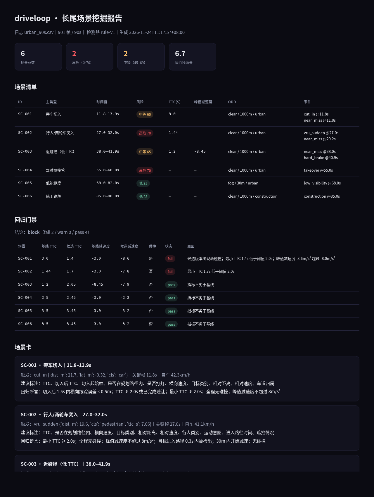

# driveloop

**从车端日志里把值得标注、值得回放、值得回归的十几秒挑出来，自动生成场景卡、OpenSCENARIO 骨架和回归报告。**

[](https://github.com/lyuyang0825-source/driveloop/actions/workflows/ci.yml)


> 只用 CAN 信号 + 感知目标 + 天气/接管状态，不依赖高精地图，不训练端到端大模型。
>
> 这是四个行业独立仓库之一 · [总览与另外三个产品](https://github.com/lyuyang0825-source/ai-industry-labs)

## 为什么做这个方向

智能驾驶的瓶颈已经从“模型结构”转向“数据工程”：

- 采集回来的数据真正能用于训练的比例不到 **5%**，绝大多数是重复的直道跟车；
- 标注通常吃掉一个 ML 项目 **80%** 的工作量；
- 长尾场景天然稀疏：Waymo 的 WOD-E2E 从 **640 万英里** 里只筛出 **4021 段 20 秒**片段，出现频率 **<0.03%**；
- 半自动标注渗透率从 2023 年的 28% 升到 2025 年的 **67%**，工具市场 2025 年约 **13.04 亿美元**，预计 2032 年 **97 亿美元**（CAGR 33.2%）。

真正稀缺的不是“再训一个更大的模型”，而是**把长尾找出来、讲清楚、可复现地回归**。这个仓库做的是这一层。

## 它产出什么

- **场景卡**：主类型、时间窗、关键帧、风险分、ODD、触发事件明细；
- **建议标注字段**：给标注员的任务单，不是泛泛的“标注一下”；
- **回归断言**：给仿真/评测，例如“最小 TTC ≥ 2.0s、全程无碰撞”；
- **OpenSCENARIO 骨架**：可直接导入仿真器，地图与路线需按项目绑定；
- **回归门禁**：候选版本相对基线，哪些场景变差、是否阻断合入。



## 快速开始

```bash
git clone https://github.com/lyuyang0825-source/driveloop.git
cd driveloop

python3 -m driveloop.cli --demo          # 合成日志 → 挖掘 → 场景卡 → OSC → 回归 → HTML
python3 -m unittest discover -s tests    # 13 tests
```

`--demo` 会生成 90 秒 / 10Hz 合成日志，挖出 6 个场景，跑一次 baseline vs candidate 回归，并把结果写到 `demo_out/`。

只挖自己的日志：

```bash
python3 -m driveloop.cli --mine data/logs/urban_90s.csv --out-dir demo_out
```

只做回归对比：

```bash
python3 -m driveloop.cli --regress data/runs/baseline_v1.json data/runs/candidate_v2.json
# 退出码：0 pass / 2 block，可直接当 CI 门禁
```

## demo 实测

| 场景 | 主类型 | 时间窗 | 风险 | 最小 TTC | 峰值减速度 |
| --- | --- | --- | --- | --- | --- |
| SC-001 | 旁车切入 | 11.8–13.9s | 60 | 3.0s | — |
| SC-002 | 行人/两轮车突入 | 27.0–32.0s | 70 | 1.44s | — |
| SC-003 | 近碰撞（低 TTC） | 38.0–41.9s | 65 | 1.2s | -8.45m/s² |
| SC-004 | 驾驶员接管 | 55.0–60.0s | 70 | — | — |
| SC-005 | 低能见度 | 68.0–82.0s | 35 | — | — |
| SC-006 | 施工路段 | 85.0–90.0s | 25 | — | — |

回归 demo：候选版本在 SC-001 出现新碰撞、SC-002 的 TTC 降到 1.7s，门禁 `block`（fail 2 / pass 4）。

## 检测器

| 类型 | 判定 | 基础分 |
| --- | --- | --- |
| `hard_brake` | 纵向减速度 ≤ -6m/s² 且车速 >15km/h | 40 |
| `takeover` | `driver_state != engaged` | 70 |
| `low_visibility` | 能见度 <50m | 35 |
| `construction` | 路型为施工 | 25 |
| `speed_over` | 超速 >10km/h | 20 |
| `near_miss` | 路径内目标 TTC <4s（<2.5s 记 60） | 45/60 |
| `cut_in` | 邻车道目标 0.8s 内进入路径且距离 <35m | 55 |
| `vru_sudden` | 行人/两轮车进入路径且距离 <20m，或 TTC <4s | 65 |

后处理两步，避免“一段危险工况碎成十几条”：

1. 同类事件间隔 ≤2.5s 合并；
2. 不同类型事件间隔 ≤2.5s 聚成一个场景，风险分 = 最高基础分 + 每多一种类型 +5（封顶 100）。

事件保留**最坏值**而不是第一条：`near_miss` 取最小 TTC，`hard_brake` 取最大减速度，因此场景卡上的数字是这段里最难的那一帧。

## 回归判定

| 条件 | 结论 |
| --- | --- |
| 候选出现新碰撞 | fail（阻断） |
| 最小 TTC <2.0s，或比基线下降 >0.35s | fail |
| 峰值减速度 < -8m/s² | fail |
| 接管次数比基线多 2 次以上 | warn |
| 其余 | pass |

门禁输出 `pass / review / block` 三态，`--regress` 在 block 时返回退出码 2。

## 输入格式

CSV，一行一个 10Hz 帧，字段见 `driveloop/schema.py`：

| 字段 | 含义 |
| --- | --- |
| `t` / `speed_kph` | 时间戳、自车速度 |
| `accel_long` / `accel_lat` / `steer_deg` | 纵向/横向加速度、方向盘角 |
| `brake` / `throttle` | 制动/油门开度 |
| `lane_id` / `lane_offset` | 车道编号、横向偏移（无地图时可给 -1） |
| `weather` / `visibility_m` | 天气、能见度 |
| `road_type` / `speed_limit_kph` | 路型、限速 |
| `driver_state` | `engaged` / `takeover` / `disengaged` |
| `objects` | 感知目标列表：`id:cls:dist_m:rel_speed_kph:lat_m:in_path`，用 `|` 分隔 |

`objects` 里的 `in_path` 是“是否在本车规划路径内”，这一位比经纬度更关键：它决定了 TTC 和 cut-in 能不能算。

## 输出目录

```
demo_out/
├── scenarios.json      # 场景卡（机器可读）
├── scenarios.md        # 场景卡（人可读）
├── scenarios.csv       # 给数据运营派活用
├── osc/SC-*.xosc       # OpenSCENARIO 最小骨架
├── regression.json     # 回归对比 + 门禁结论
└── report.html         # 单文件报告，双击可看
```

## 边界与合规

- **不是**感知/规划算法，不替代仿真器；OSC 只给骨架，`roadId`、`laneId`、路线要按项目地图绑定。
- **不落地原始视频**：默认只处理结构化信号与目标列表；若接入视频，需先做人脸/车牌脱敏、位置模糊化，并遵守测绘与数据出境要求。
- 合成日志只用于跑通链路，不能用来证明任何安全指标。
- 风险分是**规则基线**，用于排序和派活，不构成安全认证结论。

## 当前限制

- 合成日志没有碰撞动力学，目标可能穿过自车；真实接入需换成实车/仿真日志。
- 检测阈值按城市工况调，高速/泊车需要独立参数。
- OSC 是骨架，不是可直接运行的完整场景。
- 回归指标（TTC、减速度、接管次数）来自外部仿真或实车回放，本仓库只做对比与门禁。

## 路线图

- [ ] 接入真实数据集格式（nuScenes / OpenDV / ROS bag 转换）
- [ ] 主动学习采样：按场景密度与模型不确定性挑帧
- [ ] 4D 自动标注：离线大模型预标 + 人工抽检
- [ ] 场景生成：对高危场景做 NeRF/扩散增广
- [ ] 把 `--regress` 接进 CI，每次模型/规则变更自动跑门禁

## 目录

```
driveloop/
├── driveloop/
│   ├── schema.py     # CSV 字段、Frame/Track、读写
│   ├── synth.py      # 90 秒 / 10Hz 合成日志
│   ├── detect.py     # 8 类检测器、事件合并、场景聚类
│   ├── scenario.py   # 场景卡、OpenSCENARIO 骨架
│   ├── regression.py # 基线/候选对比与门禁
│   ├── report.py     # 单文件 HTML 报告
│   └── cli.py
├── data/
│   ├── logs/         # 合成日志（--demo 重建）
│   └── runs/         # baseline / candidate 指标
├── tests/            # 13 个单测
├── demo_out/         # 场景卡、OSC、回归、报告
├── docs/
│   ├── industry.md
│   ├── architecture.md
│   └── assets/report.png
└── .github/workflows/ci.yml
```

更多：[行业调研](docs/industry.md) · [架构与设计取舍](docs/architecture.md)
