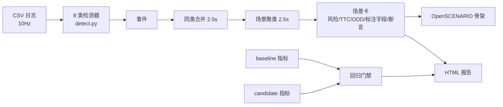

# 架构与设计取舍

## 目标 / 非目标

**目标**

- 从结构化车端日志里挖出值得标注/回放/回归的危险片段；
- 每个片段产出人可读的场景卡与机器可用的指标；
- 能把场景转成 OpenSCENARIO 骨架；
- 能对 baseline / candidate 做安全指标对比，给出放行结论。

**非目标**

- 不做感知、规划、控制算法；
- 不替代仿真器与安全认证；
- 不依赖高精地图与人工看片。

## 数据流

## 输入模型

一行一个 10Hz 帧，核心字段：

| 字段 | 用途 |
| --- | --- |
| `speed_kph` / `accel_long` | 急刹、超速、TTC 计算 |
| `objects` | 目标类别、距离、相对速度、横向偏移、`in_path` |
| `weather` / `visibility_m` | 低能见度场景 |
| `road_type` / `speed_limit_kph` | 施工、超速 |
| `driver_state` | 接管事件 |

`in_path` 比经纬度更关键：它决定 TTC 与 cut-in 能不能算，因此不要求高精地图。

## 检测器

| 类型 | 判定 | 基础分 |
| --- | --- | --- |
| `hard_brake` | 纵向减速度 ≤ -6m/s² 且车速 >15km/h | 40 |
| `takeover` | `driver_state != engaged` | 70 |
| `low_visibility` | 能见度 <50m | 35 |
| `construction` | 路型为施工 | 25 |
| `speed_over` | 超速 >10km/h | 20 |
| `near_miss` | 路径内目标 TTC <4s（<2.5s 记 60） | 45/60 |
| `cut_in` | 邻车道目标 0.8s 内进入路径且距离 <35m | 55 |
| `vru_sudden` | 行人/两轮车进入路径且距离 <20m，或 TTC <4s | 65 |

## 聚合逻辑

1. 同类事件间隔 ≤2.5s 合并；
2. 不同类型事件间隔 ≤2.5s 聚成一个场景；
3. 风险分 = 最高基础分 + 每多一种类型 +5（封顶 100）；
4. 事件保留**最坏值**：`near_miss` 取最小 TTC，`hard_brake` 取最大减速度；
5. 场景卡的主类型按优先级取名（接管 > VRU > cut-in > near_miss > …）。

这样可以避免“一段 12 秒的危险工况被拆成 18 条事件”，也避免场景卡上写的是第一帧而不是最危险那帧。

## 回归门禁

| 条件 | 结论 |
| --- | --- |
| 候选出现新碰撞 | fail |
| 最小 TTC <2.0s，或比基线下降 >0.35s | fail |
| 峰值减速度 < -8m/s² | fail |
| 接管次数比基线多 2 次以上 | warn |
| 其余 | pass |

`--regress` 返回退出码 0/2，可直接进 CI。

## 失败模式与处理

| 失败 | 表现 | 当前处理 |
| --- | --- | --- |
| 合成日志物理不真实 | 目标穿过自车、无碰撞动力学 | 明确声明只用于跑通链路，不用于证明安全指标 |
| 场景聚类过粗 | 两个独立工况被并成一个 | 2.5s 可配置；按项目标注节奏调 |
| cut-in 误判 | 目标短暂 `in_path` 抖动 | 要求前 0.8s 曾在路径外，并限制距离 |
| OSC 不能直接跑 | 缺 `roadId` / 路线 | 只产骨架，绑定地图是使用方责任 |
| 指标不可比 | 不同版本场景集不一致 | 回归按 `scenario_id` 对齐，缺场景会显式报出 |

## 扩展点

- **新增检测器**：在 `detect.py` 产出 `raw` 元组，再在 `PRIORITY` / `TYPE_LABELS` 注册；
- **接入真实数据**：把 ROS bag / nuScenes 转成 `CSV_FIELDS`；
- **主动学习**：按场景密度与模型不确定性采样，替换按时间均匀抽帧；
- **场景生成**：对高危场景做 NeRF/扩散增广，补稀有组合；
- **CI 门禁**：把 `--regress` 接到模型/规则变更流水线。
